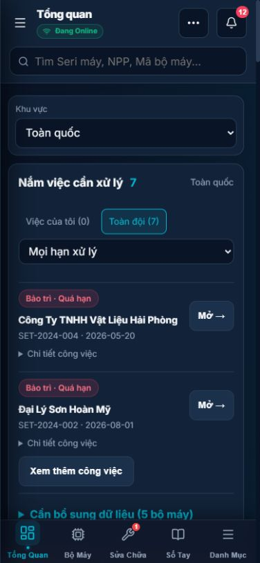

  

<h1 align="center">NASUN</h1>

<strong>Hệ thống quản lý máy pha màu và công việc kỹ thuật</strong>

Quản lý nhà phân phối, thiết bị, lắp đặt, sửa chữa và bảo trì theo miền Bắc · Trung · Nam.

<a href="https://kythuat.nasun.workers.dev/">Mở ứng dụng NASUN</a>

## 1. Ứng dụng dùng để làm gì?

NASUN hỗ trợ đội kỹ thuật theo dõi vòng đời bộ máy pha màu tại các nhà phân phối (NPP): từ nhập kho, ghép bộ, lắp đặt đến bảo trì, sửa chữa, đổi thiết bị và thu hồi. Thông tin thiết bị và công việc được tập trung để giảm việc tra cứu rời rạc và giúp kỹ thuật viên biết việc cần xử lý trong khu vực phụ trách.

Ứng dụng phục vụ công tác quản lý và kỹ thuật hiện trường. Các chức năng trong README không đồng nghĩa với khả năng điều khiển trực tiếp phần cứng máy pha màu.

## 2. Hình ảnh minh họa

Ảnh dưới đây được chụp từ bản demo sử dụng dữ liệu mẫu trong dự án, không phải dữ liệu vận hành thật. Đây là giao diện mobile trong trình duyệt, không phải bằng chứng kiểm thử trên iPhone thật. Giao diện thực tế có thể thay đổi theo phiên bản và quyền tài khoản.

<table>
  <tr>
    <th>Tổng quan và công việc cần xử lý</th>
    <th>Nhà phân phối và bộ lọc theo miền</th>
  </tr>
  <tr>
    <td align="center"></td>
    <td align="center"></td>
  </tr>
</table>

## 3. Tính năng chính

| Nhóm chức năng | Nội dung |
| --- | --- |
| Tổng quan | Theo dõi bộ máy, thiết bị tồn kho, số liệu theo miền và công việc cần xử lý. |
| Nhà phân phối | Quản lý mã NPP, liên hệ, địa chỉ, miền phụ trách, trạng thái hợp tác và bộ máy liên kết. |
| Bộ máy và kho thiết bị | Quản lý máy tính, máy chiết, máy lắc, máy in; ghép bộ, theo dõi cấp phát và thiết bị tự do trong kho. |
| Hồ sơ máy | Tra cứu mã quản lý, seri, cấu hình, phần mềm pha màu, phiên bản và thông tin ổn áp. |
| Xử lý và sửa chữa | Tạo phiếu, giữ bản nháp trên thiết bị, cập nhật nội dung, tiến độ và kết quả xử lý. |
| Bảo trì | Theo dõi lịch bảo trì và công việc đến hạn hoặc quá hạn. |
| Công việc đội kỹ thuật | Ưu tiên thông tin miền phụ trách, phát hiện dữ liệu còn thiếu và mở công việc liên quan. |
| Bản đồ tuyến đường | Tra cứu NPP trên bản đồ và mở chỉ đường tới địa chỉ. |
| Tài khoản | Đăng ký, xác minh email, đăng nhập, khôi phục mật khẩu và phân quyền. |
| Điện thoại và đồng bộ | Giao diện thích ứng màn hình nhỏ, hỗ trợ dữ liệu chờ gửi khi kết nối gián đoạn. |

## 4. Quy trình sử dụng

**Nhập thiết bị vào kho → Ghép bộ máy → Cấp phát cho NPP → Theo dõi vận hành → Sửa chữa / bảo trì → Đổi thiết bị hoặc thu hồi.**

1. Admin thiết lập tài khoản và miền phụ trách.
2. Người có quyền nhập thiết bị, kiểm tra mã quản lý và thông tin còn thiếu.
3. Ghép bộ, liên kết với NPP và cập nhật hồ sơ lắp đặt.
4. Kỹ thuật viên theo dõi công việc, bổ sung hồ sơ và cập nhật phiếu xử lý.
5. Kiểm tra trạng thái đồng bộ để biết nội dung đã được gửi hay còn chờ xử lý.

## 5. Phân quyền theo miền

| Tài khoản | Xem thông tin | Chỉnh sửa |
| --- | --- | --- |
| Admin | Toàn quốc | Quản trị dữ liệu và phân quyền theo chức năng được cấp. |
| Kỹ thuật viên | Toàn quốc, ưu tiên miền phụ trách | Chỉ dữ liệu thuộc miền được giao. |
| Viewer | Toàn quốc | Chỉ xem. |

Các vai trò nghiệp vụ khác tuân theo cấu hình quyền trong hệ thống. Quyền sửa phải được kiểm tra ở phía cơ sở dữ liệu; ẩn nút trên giao diện không thay thế việc kiểm soát truy cập.

## 6. Bảo mật và bảo vệ dữ liệu

1. **Xác thực:** sử dụng Supabase Auth; email xác minh và khôi phục phụ thuộc cấu hình gửi email của hệ thống.
2. **Phân quyền:** kết hợp quyền theo vai trò, miền phụ trách và chính sách Row Level Security (RLS) ở cơ sở dữ liệu.
3. **Kiểm tra thao tác:** kiểm tra dữ liệu nhập, phiên người dùng và kết quả ghi; lỗi quyền hoặc xung đột phải được hiển thị để xử lý.
4. **Bảo vệ khóa:** thông tin bí mật được cấu hình qua biến môi trường và GitHub Secrets. Không đưa khóa service-role vào mã chạy trên trình duyệt.
5. **Truy vết:** hệ thống có nhật ký thao tác và các cơ chế bảo vệ lịch sử kiểm toán.
6. **Sao lưu:** có workflow sao lưu mã hóa và kiểm tra bảo toàn dữ liệu cho các thay đổi database liên quan.
7. **Phát hành:** workflow deploy kiểm tra mã nguồn, build, phân quyền staging và tình trạng website sau triển khai; repository có kiểm tra bí mật và phân tích bảo mật.

Các biện pháp này cần được duy trì cùng cấu hình và quy trình vận hành; dự án không tuyên bố chứng nhận bảo mật độc lập.

## 7. Mạng yếu và dữ liệu chờ đồng bộ

Một số thao tác có thể được giữ trong hàng đợi trên thiết bị khi gặp lỗi kết nối tạm thời. Trạng thái chờ gửi không đồng nghĩa với việc dữ liệu đã lưu trên máy chủ. Lỗi phân quyền, dữ liệu không hợp lệ hoặc xung đột cần được kiểm tra trước khi thử lại.

Bản nháp phiếu được lưu theo tài khoản trên thiết bị đang sử dụng; không mặc định xuất hiện trên điện thoại hoặc máy tính khác. Khi còn dữ liệu chưa gửi, tránh xóa dữ liệu trình duyệt hoặc gỡ ứng dụng.

## 8. Công nghệ

| Thành phần | Công nghệ |
| --- | --- |
| Giao diện | React, Vite, CSS, Lucide, Recharts |
| Dữ liệu và xác thực | Supabase, PostgreSQL, Auth, Storage |
| Hosting | Cloudflare Workers |
| Phát hành và kiểm tra | GitHub Actions, Node.js tests, lint, kiểm tra RLS staging |

## 9. Chạy dự án để phát triển

1. Cài Node.js theo phiên bản ghi trong `.node-version` và tải repository.
2. Chạy `npm ci`.
3. Sao chép `.env.example` thành `.env`, cấu hình cho môi trường phát triển hoặc staging. Không commit `.env`.
4. Chạy `npm run dev` và mở địa chỉ được terminal hiển thị.
5. Trước khi phát hành, chạy `npm run test:all`, `npm run lint` và `npm run build`.

Production cần cấu hình riêng cho Supabase, email, Cloudflare và GitHub Actions. Không dùng dữ liệu thật để tạo bộ dữ liệu kiểm thử công khai.

## 10. Kiểm thử và phát hành

**Sửa lỗi → Kiểm thử tự động → Build → Cập nhật main → Chạy workflow deploy → Kiểm tra RLS staging → Triển khai Cloudflare → Xác minh website.**

Thay đổi database cần được đánh giá riêng, sao lưu và kiểm tra trên staging trước khi áp dụng production. Kiểm thử tự động không thay thế việc kiểm tra thao tác thực tế trên điện thoại, chất lượng mạng hoặc khả năng khôi phục dữ liệu.

## 11. Phạm vi và trạng thái

Ứng dụng được cập nhật theo từng đợt phát hành. Kiểm tra [GitHub Actions](https://github.com/dat291296/hethong-may-pha-mau-nasun/actions) để biết bản triển khai đã thành công; commit lên GitHub chưa đồng nghĩa website đã cập nhật.

Kiểm thử toàn bộ luồng trên iPhone thật vẫn cần hoàn tất. Công cụ kiểm thử mobile được cấu hình riêng trên máy phát triển và không đi kèm bản ứng dụng web.
